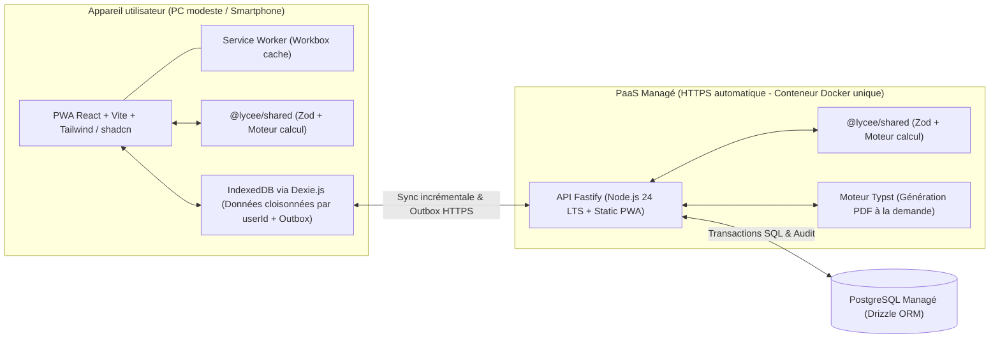
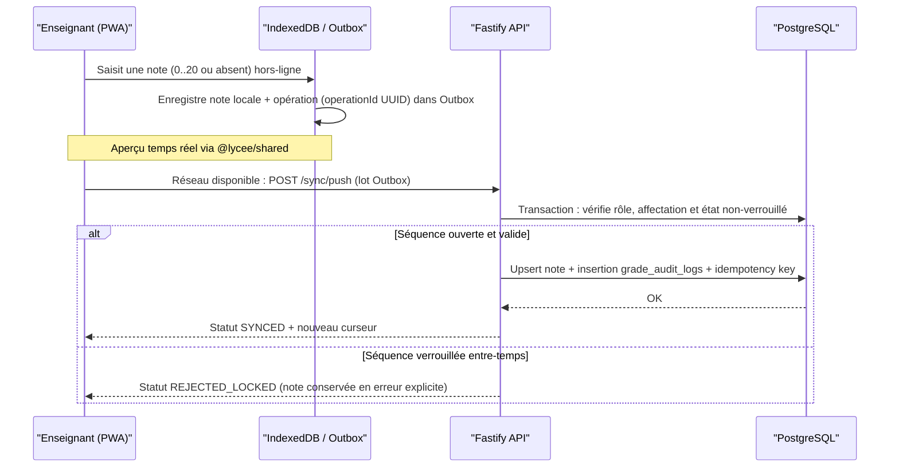

# Architecture technique & Décisions d'architecture (ADR)

Ce document décrit l'architecture technique retenue pour **gestion-notes-lycee**, les décisions structurantes (ADR) et les flux critiques du système.

---

## 1. Principes directeurs

1. **Offline-first pragmatique** : la saisie et la consultation des notes doivent fonctionner sans connexion internet fiable (PWA + IndexedDB), tout en conservant le serveur PostgreSQL comme **source de vérité officielle** pour la validation, le verrouillage et l'audit.
2. **Calculs strictement identiques client/serveur** : le code de calcul des moyennes, pondérations et rangs vit dans un module TypeScript unique (`packages/shared`) exécuté à la fois dans le navigateur (aperçu hors-ligne immédiat) et sur le serveur (calcul officiel).
3. **Empreinte légère** : faible consommation de RAM/CPU sur le serveur et bundle client minimal pour les PC modestes et connexions 3G/4G instables.
4. **Simplicité d'exploitation** : modèle mono-établissement (une instance par lycée) packagé en un seul conteneur Docker déployable sur PaaS managé, sans stockage objet S3 ni administration système complexe.

---

## 2. Vue d'ensemble de l'architecture

---

## 3. Décisions d'architecture (ADR)

### ADR-01 : Application web PWA hors-ligne & interface légère

- **Décision** : Développer le client sous forme de **Progressive Web App (PWA)** avec `React`, `TypeScript`, `Vite` et `vite-plugin-pwa` (Workbox), avec une UI bâtie sur `Tailwind CSS` et des composants accessibles légers (`shadcn/ui` / Radix).
- **Raison** :
  - Aucune installation manuelle sur les PC et téléphones des enseignants ; mises à jour automatiques dès qu'une connexion est détectée.
  - Le Service Worker met en cache les assets statiques pour un démarrage instantané hors-ligne.
  - `Tailwind CSS` + Radix produit un bundle nettement plus léger que les bibliothèques d'entreprise lourdes, tout en permettant une saisie rapide au clavier (navigation cellule par cellule façon tableur).

### ADR-02 : Synchronisation hors-ligne via IndexedDB (`Dexie.js`) & Pattern Outbox

- **Décision** : Utiliser `IndexedDB` via `Dexie.js` côté client avec une **file d'attente de mutations (Outbox)** et une API de synchronisation incrémentale côté serveur, plutôt qu'un moteur de réplication générique (PowerSync, ElectricSQL ou CouchDB/PouchDB).
- **Raison** :
  - Aucun service d'infrastructure additionnel à maintenir sur le PaaS.
  - Le périmètre téléchargé est filtré par rôle : un enseignant ne synchronise que ses affectations (`classe`, `matière`, `élèves` et `notes` de la période), sans répliquer toute la base de l'établissement.
  - Le serveur applique strictement les règles métier lors de la synchronisation : contrôle d'accès, validation des notes (`0 <= note <= 20`), rejet en cas de **séquence verrouillée**, et écriture dans l'historique d'audit.

### ADR-03 : Authentification et sécurité sur postes partagés

- **Décision** : Authentification initiale **en ligne** via JWT d'accès + refresh token, couplée à un **code PIN local** pour déverrouiller la session hors-ligne et à un **cloisonnement des données IndexedDB par `userId`**.
- **Raison** :
  - Au lycée, certains postes (salle des profs, secrétariat) peuvent être partagés entre plusieurs membres du personnel.
  - Le cloisonnement par `userId` empêche l'accès aux données locales d'un collègue sur le même navigateur.
  - Le code PIN local (vérifié hors-ligne via un hash salé stocké localement) permet de verrouiller rapidement l'écran et de changer d'utilisateur sans connexion internet.
  - Si un compte ou un jeton est révoqué côté serveur, la prochaine synchronisation est bloquée en préservant les brouillons locaux en attente d'une ré-authentification en ligne.

### ADR-04 : Backend `Fastify` + `PostgreSQL` managé avec `Drizzle ORM`

- **Décision** : Construire le serveur avec `Node.js 24 LTS`, `Fastify`, `TypeScript` et `Drizzle ORM` sur `PostgreSQL` managé.
- **Raison** :
  - Stack TypeScript unifiée de bout en bout (`apps/web`, `apps/api`, `packages/shared`).
  - `Drizzle ORM` offre une très faible empreinte mémoire et un contrôle SQL explicite pour les transactions critiques (verrouillage de séquence, insertion en lot de notes, écriture atomique dans `grade_audit_logs`, calcul de rangs).

### ADR-05 : Moteur de calcul partagé paramétrable (`@lycee/shared`)

- **Décision** : Isoler la logique métier de calcul et les schémas `Zod` dans `packages/shared`. Le modèle de notation est **paramétrable par année scolaire**, tout en étant **pré-rempli avec le standard camerounais** (3 trimestres, 6 séquences à poids égal, notes sur `20`, groupes de matières, seuils configurables).
- **Raison** :
  - Garantit zéro divergence entre la moyenne prévisualisée hors-ligne par l'enseignant et le bulletin officiel généré par le serveur.
  - Évite une refonte de la base de données si l'administration du lycée applique des pondérations spécifiques entre évaluations, des groupes de matières particuliers ou des seuils propres pour les tableaux d'honneur et décisions de passage.

### ADR-06 : Génération des bulletins PDF avec `Typst` + cache PWA

- **Décision** : Générer les bulletins individuels, bulletins par classe et tableaux de résultats côté serveur avec **`Typst`** de façon déterministe à la demande, puis mettre en cache les PDF téléchargés dans la PWA pour consultation/réimpression hors-ligne. Le logo de l'établissement est stocké directement dans PostgreSQL.
- **Raison** :
  - `Typst` consomme très peu de RAM (contrairement à Chromium/Playwright headless) et compile des dizaines de bulletins tabulaires en une fraction de seconde.
  - La génération déterministe à partir des données verrouillées évite de dépendre d'un disque persistant (les conteneurs PaaS ayant un système de fichiers éphémère) et supprime le besoin d'un bucket S3/R2.
  - Les PC modestes du secrétariat reçoivent directement un PDF prêt à imprimer, mis en cache localement pour résister aux coupures réseau au moment de l'impression.

### ADR-07 : Structure Monorepo `pnpm` & Conteneur Docker unique sur PaaS managé

- **Décision** : Organiser le dépôt en monorepo `pnpm` (`apps/web`, `apps/api`, `packages/shared`) et déployer un **conteneur Docker unique** (Node.js + binaire `typst` + `apps/api` servant aussi les fichiers statiques de `apps/web`) sur un PaaS managé (Railway, Render ou Fly.io) avec PostgreSQL managé.
- **Raison** :
  - HTTPS automatique fourni par le PaaS (condition obligatoire pour l'enregistrement du Service Worker PWA).
  - Même origine HTTP pour l'API et la PWA : aucun problème de configuration CORS, cookies/en-têtes simplifiés et déploiement atomique.
  - Mono-établissement par instance : base simple et isolée, facilement duplicable pour un autre lycée.

---

## 4. Flux critiques

### 4.1 Cycle de saisie et synchronisation des notes (Outbox)

### 4.2 Verrouillage de séquence et génération de bulletins

1. Le **Censeur / Administrateur** contrôle la complétude des saisies par classe et matière.
2. Le **verrouillage d'une séquence** s'effectue en ligne dans une transaction PostgreSQL :
   - Marque la période comme verrouillée (`locked_at`, `locked_by`).
   - Calcule et fige le snapshot officiel des moyennes par matière, moyennes générales, rangs et statistiques de classe (tout en gardant le calcul reproductible par `@lycee/shared`).
3. Le **Secrétariat** ou le **Proviseur** génère le bulletin PDF (individuel ou classe complète) via `GET /api/reports/...` : `Fastify` assemble les données verrouillées, invoque `typst` en mémoire/temp, renvoie le PDF avec en-têtes de cache et le stocke côté PWA pour réimpression hors-ligne.

---

## 5. Modèle conceptuel des données principales

Le schéma PostgreSQL (géré via Drizzle ORM) s'articule autour des entités suivantes :

- **Établissement & configuration** :
  - `school_profile` : nom, devise, ville/délégation, année active, logo binaire (`bytea`).
  - `academic_years` : années scolaires, statut actif/archivé.
  - `grading_rules` : configuration des périodes par année, pondérations, seuils d'appréciations, seuils de tableau d'honneur et de passage (pré-remplis au standard camerounais).
  - `periods` : trimestres et séquences rattachées, statut (`open`, `locked`), horodatage de verrouillage.
- **Structure pédagogique** :
  - `classes` : niveau, série/filière, libellé, effectif.
  - `students` : matricule unique, nom, prénom, date de naissance, sexe, statut redoublant.
  - `enrollments` : inscription d'un élève dans une classe pour une année scolaire.
  - `subject_groups` & `subjects` : matières et groupes (ex. Groupe 1, 2, 3).
  - `class_subjects` : coefficients des matières par classe.
- **Utilisateurs & droits** :
  - `users` : identifiants, mot de passe hashé (Argon2/scrypt), rôle (`admin`, `censor`, `principal`, `teacher`, `secretary`), statut actif.
  - `teacher_assignments` : affectation `(enseignant, classe, matière, année scolaire)`.
- **Notes, audit & bulletins** :
  - `assessments` / `grades` : notes sur `20`, statut (`present`, `absent`, `excused`), clé d'idempotence `operation_id`, version/horodatage pour delta sync.
  - `grade_audit_logs` : ancienne valeur, nouvelle valeur, auteur, motif, horodatage client et serveur.
  - `council_decisions` : appréciations générales et décisions du conseil de classe par élève et période.

---

## 6. Stratégie de qualité et de tests

La fiabilité des calculs étant l'exigence centrale du projet :

- **Tests unitaires critiques (`Vitest`)** : couverture complète de `@lycee/shared` (arrondis, coefficients, gestion des absences/notes manquantes, ex æquo dans les rangs, moyennes trimestrielles et annuelles).
- **Tests d'intégration API & synchronisation** : vérification du cloisonnement RBAC, de l'idempotence de l'Outbox (double envoi sans doublon), du rejet des mutations sur séquence verrouillée et de l'écriture systématique dans `grade_audit_logs`.
- **Contrôle de qualité statique** : TypeScript `strict: true` sur tout le monorepo, validation `Zod` aux frontières API et IndexedDB.

---

## 7. Points ouverts avant la mise en production

Avant de figer les gabarits `Typst` définitifs et les valeurs de configuration initiales, les éléments suivants devront être validés avec la direction du lycée :

- Modèle exact du bulletin officiel (colonnes attendues, mentions bilingues éventuelles, bloc de signatures).
- Règles exactes de pondération entre séquences/trimestres et traitement des absences justifiées ou non justifiées.
- Seuils officiels des mentions, tableaux d'honneur, avertissements et décisions de passage/redoublement.
